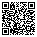
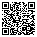
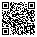
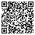

# Support MPE Roll

MPE Roll is free and open source, with no ads and no tracking. If it helps you, a donation keeps it going.

## Send a donation

- **[Cash App](https://cash.app/$freener)**

These open the payment site; nothing from MPE Roll is sent with them.

## Crypto

Scan a code with your wallet, or copy the address from the box under it.

### Bitcoin (BTC)



```text
bc1qw07yj62hae5nflfz6pwt8yyr57377adkclsy3t
```

### Ethereum (ETH)



```text
0x79Ff39eCD0D2520c5353e011ac1317C51dc2AC3A
```

Network: Ethereum mainnet only. Sending on another network can lose the money.

### Solana (SOL)



```text
7eE8qckeA15wD3FVjG3R6Uuw1eVrZmWohP5pS8hDFfp3
```

### Monero (XMR)



```text
84L4Twd2DcNjHevR6qUzz8fnLDzmyyLZohwG8Zs5hSmtUWMPFRjdefvPJX2L89wZcahvCCgpBRwZRcP84V3vzHWPNqHx4TR
```

Private by design: your donation stays private too.

---

[docs/donate.html](docs/donate.html) is this page as one file with copy buttons; open it from a checkout, or serve it with GitHub Pages. Both pages, the QR codes and `.github/FUNDING.yml` are made by `tools/make_donate_page.py` from [docs/donate.json](docs/donate.json): change the JSON and run the script rather than editing them.
