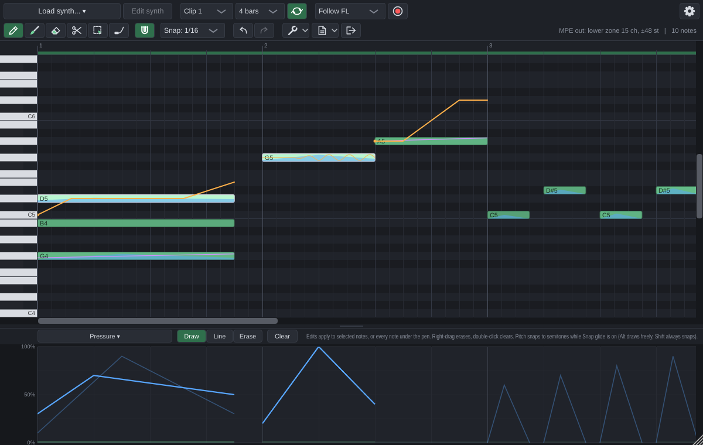

# MPE Roll

An MPE piano roll for FL Studio. MPE Roll is an instrument plugin (VST3, plus AU on macOS and a
standalone app) with its own piano roll. You load your synth *inside* it (VST3, VST2 or CLAP), so
every note gets its own pitch glide, pressure, timbre and controllers. FL Studio's own piano roll
can't send per-note expression to plugins.

For FL's native synths (FLEX, Sytrus, Harmor, 3xOsc...), which can't receive MPE at all, MPE Roll
writes a piano roll script. The script rebuilds the clip in FL's own piano roll using slide notes,
fine pitch and Mod X / Mod Y.



> **Status:** early version. The MPE engine, MIDI files, recording and the FL script are covered by
> automated tests, and every change is built and tested on Windows, macOS and Linux. The plugin is
> checked end to end against VST3, VST2 and CLAP test synths, and release 0.1.0 has been **tested in
> FL Studio on Windows 11** (26.1.7) with Analog Lab (VST2 and VST3), Omnisphere 3, Surge XT as
> CLAP, the installer and the script bridge; see [Known limitations](#known-limitations).

## What it does

**Every MPE expression, per note**

| Expression | Sent to the synth as |
| --- | --- |
| Strike (note-on velocity) | Note On velocity, optionally 14-bit with a CC88 prefix |
| Lift (release velocity) | Note Off velocity, optionally 14-bit with a CC88 prefix |
| Glide (pitch) | 14-bit pitch bend on the note's channel, any range up to ±96 semitones |
| Vibrato (depth drawn per note, speed in Hz per clip) | Played by MPE Roll as part of the note's pitch bend, so it needs the same bend range setup as glides (in Plain MIDI, the newest note's) |
| Press (pressure) | Channel pressure, poly aftertouch or a CC of your choice |
| Slide (timbre) | CC74 (or any CC), optionally 14-bit with an LSB controller |
| Any other controller | That CC on the note's own channel: pan, volume, expression, vibrato rate/depth... |

**CLAP synths get it natively.** A CLAP synth is played with CLAP notes and *note expressions*
instead of MPE MIDI, so there are no channels or bend ranges to set up in the synth:

| MPE Roll lane | CLAP note expression |
| --- | --- |
| Glide (plus zone pitch bend) | Tuning, in semitones |
| Press (plus zone pressure) | Pressure |
| Slide (moved by zone timbre) | Brightness |
| Per-note CC7 / CC10 / CC1 / CC11 | Volume / pan / vibrato / expression |

Other zone-wide controllers, such as the sustain pedal or the mod wheel, reach the synth as MIDI on
the master channel and every member channel, so they apply to the notes whichever way the synth
handles channels. (A synth that doesn't take MIDI gets zone CC7/10/1/11 combined into its notes
instead.) Synths that only take MIDI get MPE as usual, and *MPE settings › Note expressions (CLAP,
VST3)* switches to MPE MIDI if you prefer it.

**VST3 synths are asked what they take.** A VST3 synth gets MIDI pitch bend, pressure and
controllers only on the channels it maps them on (that's how VST3 works, and JUCE's host drops the
rest). MPE Roll asks each VST3 synth which channels those are. One that maps them on every channel,
as JUCE-built synths such as Vital and Surge XT do, is played with MPE over MIDI. One that maps
pitch bend on MIDI channel 1 only but takes **VST3 note expressions** is played with those instead:
each note on channel 1 with its own ID, its glide as tuning, and its pressure and timbre as the
synth's own types for MPE's pressure and Y (plus volume, pan, vibrato and expression where it takes
them). One that takes neither can't get each note's own expression, and *MPE settings* says so and
suggests *Plain MIDI*. MPE Roll asks again every few seconds, so a synth whose own MPE switch
changes this is followed.

**Known synths come with directions.** MPE Roll knows the MPE of some 680 instruments from 180
makers, from an audit of what the major stores sell (October 2026): for one with MPE (Serum and
Serum 2, Pigments and the other Arturia instruments, Omnisphere 3, Vital, Diva, Phase Plant, Surge
XT, Equator2, Cherry Audio, SWAM, Icarus...), *MPE settings* and the status line say where its MPE
switch is; for one without (Analog Lab, ZENOLOGY and the Roland Cloud instruments, Massive X,
Sylenth1, Spire, Zebra2, Omnisphere 2, Waves...), MPE Roll offers *Plain MIDI* or *One copy per
note* when you load it.
[docs/MPE_SYNTHS.md](docs/MPE_SYNTHS.md) lists them all, with where to turn MPE on and sources.

**MPE for any synth: one copy per note.** For a synth without MPE (Serum 1.1, Analog Lab, Kontakt,
Nexus...), MPE Roll can load several copies of it (8 to start with, up to 32) and play each note on
a copy of its own, so every note keeps its own glide, vibrato, pressure and timbre. Copy 1 is the
synth you edit: its parameters reach the other copies at once, and a new preset as soon as the synth
reports it, its window closes, or you ask, without cutting notes that are playing. Quiet copies
sleep, the rest are played on several CPU cores (one set of threads for every MPE Roll), keyswitches
and modifier keys can go to every copy, and a copy that crashes (on Windows) or throws an error is
switched off instead of taking FL with it. Copies stop loading when memory runs low, and after a
crash while loading them they aren't loaded again until you ask. See
[docs/FL_STUDIO.md](docs/FL_STUDIO.md#one-copy-per-note-mpe-for-any-synth).

**Zone-wide (master channel) lanes:** pitch bend with its own range, pressure, timbre and any
controller, including the sustain, sostenuto, soft, legato and hold pedals.

**The MPE details handled for you:** lower, upper or split zones, channel rotation
(least-recently-released first), what to do when channels run out (share or steal), the MPE
Configuration Message and pitch-bend ranges, each note's starting state sent *before* its Note On,
and a plain-MIDI mode for synths that don't do MPE.

**Editing**
- FL's piano roll tools, with FL's keys, on an icon toolbar (hover for the words): **Draw (P)**
  click to add, drag to move or resize, right-click to delete, Ctrl-drag to select, Shift-drag to
  duplicate, Alt to bypass snap; **Paint (B)** drags out a run of snapped notes; **Delete (D)**;
  **Slice (C)** cuts a note where you click, or every note a vertical drag crosses, each note's
  glide and expression cut with it; **Select (E)** boxes or clicks notes.
- **Glide tool (G):** draw pitch bends straight onto notes. Glides snap to whole semitones and the
  grid (Alt draws freely).
- **Tools menu, as in FL's piano roll and with FL's keys:** quantize (Alt+Q; Ctrl+Q quick), chop
  (Alt+U; Ctrl+U quick), glue (Ctrl+G), arpeggiate (Alt+A), strum (Alt+S), flam (Alt+F), legato
  (Ctrl+L), articulate (Alt+L), limit (Alt+K), flip (Alt+Y), randomize (Alt+R) and scale levels
  (Alt+X). A tool's dialog previews on the clip as you change it, through the synth; Accept keeps it
  as one undo step. With nothing selected a tool works on every note, as in FL.
- **Expression lane:** draw, line or erase any of the lanes above, on selected notes or every note
  under the pen. The vibrato lane shows on the notes as a wavy line.
- FL's editing keys: undo/redo, copy/paste, duplicate (Ctrl+B), deselect (Ctrl+D), invert the
  selection (Shift+I), quick quantize (Ctrl+Q; Shift+Q starts only), discard lengths (Shift+D),
  transpose (↑/↓ a semitone, Ctrl an octave), nudge (←/→).
- 16 clip slots. Each plays in sync with FL (**Follow FL**) or is launched by notes from FL's piano
  roll (**Note trigger**: C0 plays slot 1, C#0 slot 2...).
- **Ten skins**, any colour of them changeable, and a background picture of your own behind the grid.

**Your synth, any format**
- Hosts VST3, VST2 and CLAP instruments (plus AU on macOS), with a plugin scanner and a crash-safe
  blacklist. The synth's own window opens from *Edit synth*.
- **Automate the synth from FL:** the synth's parameters show up as MPE Roll's parameters, named
  after them (*Synth 1* to *Synth 1024*). Move a knob in the synth's window, then use FL's
  *Tools › Last tweaked* to make an automation clip or link a controller. The link survives saving,
  even if the synth's parameters are reordered by an update.

**In and out**
- **Record** from an MPE controller. *MPE settings › Controller* has ready-made setups for ROLI
  Seaboard and LUMI, LinnStrument, Haken Continuum and ContinuuMini (including MPE+ high resolution),
  Expressive E Osmose, Ableton Push 3, Keith McMillen K-Board Pro 4 and QuNexus, Embodme Erae,
  Sensel Morph and Joué, and keyboards with poly aftertouch. Each shows how to set the controller
  up. Takes overdub into the clip as one undo step.
- **MIDI files:** import any MIDI file (MPE or not), export MPE MIDI files, or drag the *File*
  button straight into FL.
- **Export audio:** *File › Export audio as WAV / MP3* plays the clip through a copy of your synth
  (same sound, faster than real time, without touching the one playing) and writes a 24-bit WAV or a
  320 kbps MP3, including the synth's release tail.
- **Send to FL piano roll:** the bridge for FL's native synths (see below).
- The MPE stream also goes to the plugin's MIDI output, so you can route it elsewhere in FL.

## Downloading a build

**Releases.** The [latest release](https://github.com/freener0x/MPE-Roll/releases/latest) has the
Windows installer (`MPE-Roll-Setup-<version>.exe`), the Windows files (`MPE-Roll-<version>-Windows.zip`)
and the macOS bundles (`MPE-Roll-<version>-macOS.zip`) attached, with notes on what changed since the
one before ([CHANGELOG.md](CHANGELOG.md) keeps them all). From 0.2.0 on, a release also carries an
experimental Linux build (`MPE-Roll-<version>-Linux.tar.gz`) and `SHA256SUMS.txt`, the checksums of
the files ([how to check a download](docs/UNSIGNED_BUILDS.md#verify-what-you-downloaded)).

To make a release (maintainers): set the version in `CMakeLists.txt` (`project(MPE_ROLL VERSION
…)`), rename the *[Unreleased]* section of `CHANGELOG.md` to that version and the day, merge, then
either tag that commit `v<version>` and push the tag, or open the *Release* workflow under *Actions*
and *Run workflow* on `main`, which tags main's commit for you. The workflow checks the tag against
the version and that `CHANGELOG.md` has a section for it, builds everything, runs the unit tests,
the installer's test and Apple's AU validator, and publishes the release with that section in its
notes. A tag with a suffix (`v0.2.0-beta1`, or a suffix typed into *Run workflow*) is marked a
pre-release; it needs the section for its version too (`## [0.2.0]` for `v0.2.0-beta1`).

**Builds between releases.** Every code change is built by GitHub Actions (a change to the
documentation alone builds nothing).
Open the repository's **Actions** tab (you need to be signed in to GitHub), pick the latest successful
**Build** run, and download **MPE-Roll-Windows-Setup-build-N** (the installer) or
**MPE-Roll-Windows-build-N** (the files, to copy by hand) under *Artifacts* (N is the run's number,
shown as #N beside it), **MPE-Roll-macOS-build-N** for a Mac, or **MPE-Roll-Linux-build-N**
(experimental) for Linux. Each build names itself at the bottom of the File menu and of *MPE
settings*, e.g. "MPE Roll 0.1.0, build 63, f2ea3c4, 2026-10-26": the run number, the commit and the
day it was built. If that isn't the build you downloaded, the DAW loaded an older copy (see the FL
Studio guide's troubleshooting table).

**The Windows installer.** Close FL Studio and run `MPE-Roll-Setup-<version>.exe` from the release
(a build between releases comes zipped: unzip it and run `MPE-Roll-Setup-build-N.exe`).
It isn't signed, so Windows may say *Windows protected your PC*: choose *More info*, then *Run
anyway*. It installs the VST3 in `C:\Program Files\Common Files\VST3` and, unless you untick them,
the VST2 `MPE Roll.dll` (with `MPE Roll Scanner.exe` beside it) in a folder you choose, and the
standalone app in `C:\Program Files\MPE Roll` with a Start menu entry. Before installing it looks
for other copies of MPE Roll: the ones FL Studio's plugin database lists (for the Windows account
that runs the installer; copies inside FL's own folder aren't looked for), and any in the plugin
folders (`Common Files\VST3` and `VST2`, `Program Files\VST3`, the Steinberg folders and
`Program Files\VSTPlugins`, up to four folders down; the VST2 folder you choose and the registry's
`VSTPluginsPath`, two down). It removes the ones you leave ticked once any program holding them is
closed, so FL can't load an old build by mistake. Run a newer installer over it to update: 0.1.0's
installer was run over an earlier build this way on Windows 11, and CI installs, upgrades and
uninstalls every build's installer. To uninstall, use Windows' *Settings › Apps › Installed apps*;
your settings, scans and plugin log in `%APPDATA%\MPE Roll` stay.

**The Windows files**, to copy by hand instead:
- `MPE Roll.vst3`, the VST3 plugin: copy the whole folder to `C:\Program Files\Common Files\VST3`.
- `MPE Roll.dll`, the same plugin as VST2: put it in a VST plugin folder that FL Studio scans (the
  folders are listed under *Options › Manage plugins*). Install either one, or both; used together in
  one project, each keeps its own list of scanned synths and the last to save it wins.
- `MPE Roll Scanner.exe`: MPE Roll checks plugins with it in a separate process, so a plugin that
  crashes while MPE Roll scans for synths can't take FL Studio down. The `.vst3` folder already
  holds a copy; put this one next to `MPE Roll.dll` (unless the `.vst3` is installed too), and
  replace it whenever you update MPE Roll, since a scanner from another version can't check plugins.
- `MPE Roll.exe`, the standalone app, with `MPE Roll.pdb` beside it. Keep the two together: if the
  app crashes, it saves a report to `%APPDATA%\MPE Roll\Crash report.txt`, and the `.pdb` lets the
  report name the code involved.

**The macOS bundles.** A release's `MPE-Roll-<version>-macOS.zip` holds a folder `MPE Roll`; a
build between releases (**MPE-Roll-macOS-build-N**) holds one more zip, `MPE-Roll-bundles.zip`,
with that folder inside. Open the zip that holds the folder with Finder (or `ditto -x -k <zip> .`),
which keeps the app's permissions; other unzip tools can lose them, and the app then won't start.
Inside are `MPE Roll.vst3` (for `/Library/Audio/Plug-Ins/VST3`), `MPE Roll.component` (for
`/Library/Audio/Plug-Ins/Components`) and the standalone `MPE Roll.app`. Nobody has run the macOS
build yet: CI builds it on every code change, but no person has opened it on a Mac. Testers are
wanted: please say how it went, working or not, in an
[issue](https://github.com/freener0x/MPE-Roll/issues).

**The Linux build** (experimental): `MPE-Roll-<version>-Linux.tar.gz` from 0.2.0 on, or
**MPE-Roll-Linux-build-N** between releases (a zip with `MPE-Roll-Linux.tar.gz` inside). Unpacked
with `tar -xzf`, it's a folder `MPE Roll` with `MPE Roll.vst3` (copy it to `~/.vst3`), the
standalone app and the scanner. FL Studio has no Linux version, and no Linux host has run this
build yet; it's built on Ubuntu 24.04 with the libraries listed under [Building](#building).
Reports from Bitwig, Reaper or Ardour users are welcome.

These builds aren't code signed. Windows may show a SmartScreen warning for the installer and the
standalone app, and on macOS you need to remove the quarantine flag from the unzipped `MPE Roll`
folder before a DAW will load the bundles (`xattr -dr com.apple.quarantine ~/Downloads/"MPE Roll"`
for the folder unzipped in Downloads; it covers all three).
[docs/UNSIGNED_BUILDS.md](docs/UNSIGNED_BUILDS.md) says what each system shows, how to get past
it, and how to check a download.

## Building

You need CMake 3.22+ and a C++20 compiler. JUCE 9, the CLAP headers and the LAME MP3 encoder are
downloaded automatically (`-DMPEROLL_MP3=OFF` builds without MP3 export, and without LAME). The
downloaded JUCE gets a fix to its VST3 hosting from `cmake/PatchJuce.cmake`; with your own JUCE
checkout (`-DFETCHCONTENT_SOURCE_DIR_JUCE=...`), run `cmake -P path/to/PatchJuce.cmake` in it.

**Windows** (Visual Studio 2022 or 2026 with "Desktop development with C++"):

```bat
cmake -S . -B build -G "Visual Studio 17 2022" -A x64
cmake --build build --config Release --target MpeRoll_VST3
```

The plugin ends up in `build\MpeRoll_artefacts\Release\VST3\MPE Roll.vst3`. Copy that folder to
`C:\Program Files\Common Files\VST3`. Or configure with `-DMPEROLL_COPY_PLUGIN_AFTER_BUILD=ON` (from
an administrator prompt) to have it copied for you.

**macOS** (Xcode): `cmake -S . -B build -G Xcode`, then build the `MpeRoll_VST3` or `MpeRoll_AU`
scheme.

**Linux:** install JUCE's dependencies (`libasound2-dev libx11-dev libxrandr-dev libxinerama-dev
libxcursor-dev libxi-dev libxext-dev libxcomposite-dev libfreetype-dev libfontconfig1-dev`), then
`cmake -S . -B build -G Ninja && cmake --build build`.

Options: `-DMPEROLL_HOST_VST2=OFF` and `-DMPEROLL_HOST_CLAP=OFF` leave out VST2 or CLAP hosting, and
`-DMPEROLL_BUILD_DEV_TOOLS=ON` adds the test harness and test synths.

## Using it in FL Studio

The short version is below. [docs/FL_STUDIO.md](docs/FL_STUDIO.md) has the full walkthrough.

1. **Add it:** *Options › Manage plugins › Find installed plugins*, then add **MPE Roll** to the
   Channel Rack like any instrument.
2. **Load your synth:** click *Load synth…*. The first time, choose *Scan for plugins…*, or pick a
   `.vst3`, VST2 `.dll` or `.clap` file with *Load plugin file…*. *Edit synth* opens the synth's own
   window.
3. **Turn on MPE in the synth** and set its MPE pitch-bend range to **48** (or set MPE Roll's range
   to match the synth's in *MPE settings*). Synths that honour the MPE Configuration Message, like
   JUCE-based and ROLI Equator synths, set themselves up. CLAP synths that support note expressions
   need no setup at all.
4. **Write notes** in MPE Roll's piano roll and press play in FL. In *Follow FL* mode the clip follows
   the song or pattern position. In *Note trigger* mode, put notes in FL's piano roll for MPE Roll's
   channel to launch clip slots.

**Recording an MPE controller:** in FL's MIDI settings, enable the controller and give it a
**Port** number. In MPE Roll's wrapper settings (the gear icon), set the **MIDI input port** to the
same number. Pick your controller under *MPE settings › Controller*, arm *Rec* in MPE Roll and play
FL.

**FL's native synths:** click *Send to FL piano roll*. MPE Roll writes `MPE Roll Import.pyscript`
into FL's scripts folder, `Documents\Image-Line\FL Studio\Settings\Piano roll scripts`, or asks
where to save when it doesn't find that folder (pick it). In the piano roll of a native synth's
channel, run it from the piano roll menu › *Tools*, where FL lists its scripts:

- Each overlapping note gets its own colour, because slide notes only bend notes of the same colour.
- Glides become chains of slide notes, and a note's starting offset becomes fine pitch.
- Pressure and timbre become Mod X / Mod Y. Map those to whatever you like in the synth's per-note
  modulation.
- Velocity, release and per-note pan carry over. Zone pitch bend can be folded into every note, and
  the sustain pedal into note lengths.

## Known limitations

[docs/KNOWN_ISSUES.md](docs/KNOWN_ISSUES.md), the website's Known issues page, has these too, with
what to do about each one meanwhile and where it stands.

- **Tested in FL Studio on Windows 11** (26.1.7, release 0.1.0). MPE Roll loads in the Channel Rack
  and plays Arturia Analog Lab, as VST2 and as VST3 (zone-wide lanes; per-note lanes with *Plain
  MIDI*), Spectrasonics Omnisphere 3 over MPE (per-note glides, pressure and timbre included, once
  MPE is on in Omnisphere's System page) and Surge XT as CLAP (with CLAP note expressions, nothing
  set up in the synth). *Send to FL piano roll* asked where to save, because 0.1.0 writes the script
  into FL's folder by itself only when `Documents\Image-Line\FL Studio\Settings\Piano roll scripts`
  already exists where Windows keeps Documents (a fix for 0.2.0, finding FL's folder and saving
  there itself, is under way); saved there, the script is listed under the piano roll menu's
  *Tools* and runs, and the glides land in tune, so the fine-pitch unit the script uses (tenths of a
  semitone) is confirmed. The release installer upgraded an earlier build. The standalone app loads
  synths, clicks land where they're aimed after the window is reopened, and a scan that meets FL's
  own plugins says they can't be hosted. The rest of what's said here about FL (MIDI port routing
  and recording, slide notes carrying Mod X/Y ramps) follows Image-Line's documentation and forum
  reports, not tests in FL. Please open an issue with what you find.
- **With Analog Lab, release 0.1.0 fills FL's undo history with *Knob tweak (channel1 pitch bend)*
  and the like while notes glide.** Analog Lab gives each MIDI channel's pitch bend a parameter of
  its own, which follows every bend MPE Roll sends, and 0.1.0 passes those moves on to FL as edits.
  The sound isn't affected, but your own edits get buried among those entries. Fixed on main since
  3 November 2026; the next release, 0.2.0, won't have it. The FL Studio guide's troubleshooting
  table has the details.
- **Switching MPE Roll's channel off in the Channel Rack doesn't stop its sound** (0.1.0, seen in
  *Follow FL* mode, the default): FL's switch stops the notes it sends a channel, and MPE Roll plays
  its clip from FL's transport, not from notes. Mute MPE Roll's mixer track instead, or stop FL. A
  fix is under way for 0.2.0.
- **Nobody has run the macOS build yet**, nor the experimental Linux build in a Linux host. CI
  builds both and runs the tests on macOS and Linux with every code change, but no person has
  opened the macOS bundles on a Mac. Testers wanted: please say how it went, working or not, in an
  [issue](https://github.com/freener0x/MPE-Roll/issues).
- **VST3 note expressions are new.** They're tested automatically with a small non-JUCE VST3 test
  synth that maps pitch bend on channel 1 only, on Linux and Windows, but not yet with a commercial
  synth that takes them. Serum 2's guide says it takes note expressions with its own MPE switch off.
  Omnisphere 3 with its MPE off is played that way (*VST3 notes on channel 1*), but no per-note
  expression comes out of it over that path: it doesn't take VST3 note expressions, so its MPE has
  to be on (FL Studio 26.1.7, Windows 11).
- **One copy per note is new.** It's tested automatically with a small synth without MPE (VST3 and
  VST2, on Linux and Windows, where a copy crashing or throwing on purpose is switched off and never
  called again). In FL Studio 26.1.7 it plays Analog Lab (VST3), FabFilter Twin 3, Serum 1, Kontakt 8
  and Arcade with each note's own glides (a user's report); in all five the glides stopped at 2
  semitones, the synth's own pitch-bend range, until it's raised in the synth (Analog Lab's *Settings*
  tab, for instruments that have one) and *Zone bend range* set to match, which the status line now
  says when a glide goes past it. Nexus is untried. A synth may mind having many copies of itself
  (licence checks, memory); please report what you find.
- **CLAP and VST2 hosting are new.** Both are tested automatically with small test synths on
  Linux, and compiled for Windows and macOS. In FL Studio 26.1.7 on Windows 11, Surge XT's CLAP
  plays with CLAP note expressions and opens its own window separately from MPE Roll's, which says
  so and shows a *Show Surge XT* button that brings it up; no other CLAP synth's window has been
  tried. If a CLAP synth's window can't be shown at all, MPE Roll shows a message and the synth
  still plays. Please report synths that misbehave.
- VST2 hosting uses [FST](third_party/fst/README.md), a clean-room reimplementation of the VST2
  headers, because Steinberg's SDK can't be redistributed (with the opcodes FST hadn't documented
  filled in). It has been tested with a JUCE-built VST2 synth and, in FL Studio 26.1.7, with Analog
  Lab's VST2, so please report other VST2 synths that misbehave.
- The controller presets are based on each maker's documentation, not tested on the hardware.
- FL shows synth parameter slots by number until a synth is loaded. If FL keeps old names after you
  change synths, reopen the project.
- If FL also sends your controller to the *selected* Channel Rack channel, notes can play twice.
  Keep another channel selected while recording.
- FL's native synths only get what FL's piano roll can express: one colour per overlapping note, at
  most 16 at a time.

## How it's built

```
source/core/      The MPE engine. Only needs juce_core/juce_audio_basics, so it's fully unit tested.
  MpeClip           notes, expression curves, clip slots' data model
  MpeEncoder        notes -> MPE MIDI (zones, channel allocation, MCM/RPN, CC88, 14-bit timbre...)
  MpeDecoder        MIDI -> notes (controllers, files, FL), including MCM/RPN parsing
  ClipPlayer        sample-accurate playback with looping and note chasing
  ClipBuilder       turns decoded MIDI into notes and curves (recording, file import)
  MidiFileIO        Standard MIDI File import/export
  FlScriptExporter  the FL Studio piano roll script bridge
  ControllerPresets setups for popular MPE controllers
  NoteTools         FL's piano roll tools (chop, arpeggiate, strum, glue...) on notes and their curves
  CopyRouter        one copy per note: shares an MPE stream out over copies of a synth, one note each
source/plugin/    The plugin: processor, hosted synth, automation slots, document/undo, the editor UI.
  CopyWorkers       plays a synth's copies on several cores (the audio thread helps, never waits idle)
  CopySafety        catches a copy that crashes (Windows) or throws, and how much memory is free
  clap/             CLAP hosting: plugin format, instance, and the MPE to note expression translator
tests/            Unit tests, plus a Python stand-in for FL's flpianoroll module that runs the
                  generated scripts.
tools/            Developer harness and tiny MPE test synths: VST3 and VST2 (JUCE), CLAP (plain CLAP
                  API, pitch only from note expressions), a VST3 one on the plain VST3 interfaces
                  that maps pitch bend on channel 1 only and takes note expressions, and a plain one
                  without MPE (VST3 and VST2) for one copy per note. Needs -DMPEROLL_BUILD_DEV_TOOLS=ON.
                  make_donate_page.py writes DONATE.md, the website's front and Support pages
                  (docs/index.html, docs/donate.html), the QR codes and .github/FUNDING.yml from
                  docs/donate.json. make_synth_list.py writes
                  docs/MPE_SYNTHS.md and source/plugin/KnownSynths.h, the synths MPE Roll knows the
                  MPE of, from docs/synths.json (CI checks they match).
third_party/fst/  Clean-room VST2 headers (GPL-3.0-or-later).
third_party/lame/ The build configuration for the LAME MP3 encoder (LAME itself is downloaded).
cmake/            Fixes and additions applied to the downloaded JUCE: an empty VST3 MIDI mapping, the
                  hosted VST3's edit controller, and VST3 note events handed over in the MIDI buffer.
```

Run the tests with `ctest --test-dir build`. With the dev tools enabled, `MpeRollHarness selftest`
and `uitest` exercise the full plugin, and `render <test synth> out.wav`, `params <test synth>`,
`clapdialect <test synth.clap>` and `vst3dialect <note expression synth.vst3> <test synth.vst3>`
check that per-note glides, parameter automation and CLAP and VST3 note expressions reach a hosted
synth, and `export <test synth> <folder>` exports a clip as WAV and MP3 and reads both back. CI runs
all of them.

## Support MPE Roll

MPE Roll is free and open source, with no ads and no tracking ([docs/PRIVACY.md](docs/PRIVACY.md)
says what it keeps on your computer). If it helps you, a donation keeps it going: see
[DONATE.md](DONATE.md) (Cash App, or Bitcoin, Ethereum, Solana and Monero by QR code). Inside the
plugin, *File > Support MPE Roll* (or the link at the foot of *MPE settings*) opens the same details
in a window of its own, QR codes and Copy buttons included, with nothing to load from the web. The
page is also on MPE Roll's website, <https://freener0x.github.io/MPE-Roll/donate.html>.

The website (<https://freener0x.github.io/MPE-Roll/>) is the `docs/` folder, which GitHub Pages
builds with Jekyll in GitHub's Cayman theme (*Settings › Pages › Build and deployment*: *Deploy from a
branch*, `main`, `/docs`). Its front page and Support page are made by `tools/make_donate_page.py`,
and the FL Studio guide, the list of synths and the Known issues, Unsigned builds and Privacy pages
become pages as they are. `docs/_config.yml` says how
it's put together. Its pages link to the repository and its licence; should the repository ever be
made private, set `"repoPublic": false` in `docs/donate.json` and run `tools/make_donate_page.py`, and
the website then links to nothing in it, since visitors would get a 404 there.

## License

AGPL-3.0, the open-source licence JUCE is available under. See [LICENSE](LICENSE). It includes the
FST headers (GPL-3.0-or-later, see [third_party/fst](third_party/fst/README.md)) and builds against the
CLAP headers (MIT). MP3 export uses [LAME](https://lame.sourceforge.io) 3.100 (LGPL-2.0-or-later),
built from its unchanged source as a static library; MPE Roll's own source being available is what
lets anyone rebuild it with another version of LAME.
