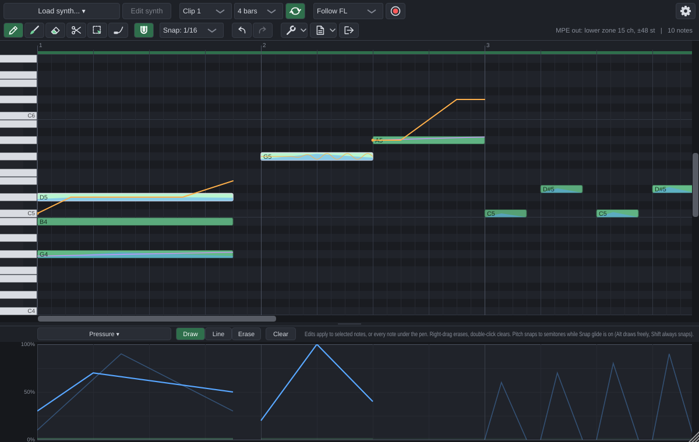

# MPE Roll

An MPE piano roll for FL Studio. MPE Roll is an instrument plugin (VST3, plus AU on macOS and a
standalone app) with its own piano roll. You load your synth *inside* it (VST3, VST2 or CLAP), so
every note gets its own pitch glide, pressure, timbre and controllers. FL Studio's own piano roll
can't send per-note expression to plugins.

For FL's native synths (FLEX, Sytrus, Harmor, 3xOsc...), which can't receive MPE at all, MPE Roll
writes a piano roll script. The script rebuilds the clip in FL's own piano roll using slide notes,
fine pitch and Mod X / Mod Y.



> **Status:** early version. The MPE engine, MIDI files, recording and the FL script are covered by
> automated tests, and every change is built and tested on Windows, macOS and Linux. The plugin is
> checked end to end against VST3, VST2 and CLAP test synths. It has **not been tried inside FL
> Studio yet**. See [Known limitations](#known-limitations).

## What it does

**Every MPE expression, per note**

| Expression | Sent to the synth as |
| --- | --- |
| Strike (note-on velocity) | Note On velocity, optionally 14-bit with a CC88 prefix |
| Lift (release velocity) | Note Off velocity, optionally 14-bit with a CC88 prefix |
| Glide (pitch) | 14-bit pitch bend on the note's channel, any range up to ±96 semitones |
| Vibrato (depth drawn per note, speed in Hz per clip) | Played by MPE Roll as part of the note's pitch bend, so any synth gets it |
| Press (pressure) | Channel pressure, poly aftertouch or a CC of your choice |
| Slide (timbre) | CC74 (or any CC), optionally 14-bit with an LSB controller |
| Any other controller | That CC on the note's own channel: pan, volume, expression, vibrato rate/depth... |

**CLAP synths get it natively.** A CLAP synth is played with CLAP notes and *note expressions*
instead of MPE MIDI, so there are no channels or bend ranges to set up in the synth:

| MPE Roll lane | CLAP note expression |
| --- | --- |
| Glide (plus zone pitch bend) | Tuning, in semitones |
| Press (plus zone pressure) | Pressure |
| Slide (moved by zone timbre) | Brightness |
| Per-note CC7 / CC10 / CC1 / CC11 | Volume / pan / vibrato / expression |

Other zone-wide controllers, such as the sustain pedal or the mod wheel, reach the synth as MIDI on
the master channel and every member channel, so they apply to the notes whichever way the synth
handles channels. (A synth that doesn't take MIDI gets zone CC7/10/1/11 combined into its notes
instead.) Synths that only take MIDI get MPE as usual, and *MPE settings › CLAP note expressions*
switches to MPE MIDI if you prefer it.

**Zone-wide (master channel) lanes:** pitch bend with its own range, pressure, timbre and any
controller, including the sustain, sostenuto, soft, legato and hold pedals.

**The MPE details handled for you:** lower, upper or split zones, channel rotation
(least-recently-released first), what to do when channels run out (share or steal), the MPE
Configuration Message and pitch-bend ranges, each note's starting state sent *before* its Note On,
and a plain-MIDI mode for synths that don't do MPE.

**Editing**
- FL-style note editing: click to add, drag to move or resize, right-click to delete, Ctrl-drag to
  select, Shift-drag to duplicate, Alt to bypass snap.
- **Paint tool (B):** drag to lay down a run of snapped notes, FL-style.
- **Glide tool (G):** draw pitch bends straight onto notes. Glides snap to whole semitones and the
  grid (Alt draws freely).
- **Expression lane:** draw, line or erase any of the lanes above, on selected notes or every note
  under the pen. The vibrato lane shows on the notes as a wavy line.
- Undo/redo, copy/paste, duplicate (Ctrl+D/B), quantize (Q), transpose (↑/↓), nudge (←/→).
- 16 clip slots. Each plays in sync with FL (**Follow FL**) or is launched by notes from FL's piano
  roll (**Note trigger**: C0 plays slot 1, C#0 slot 2...).
- **Ten skins**, any colour of them changeable, and a background picture of your own behind the grid.

**Your synth, any format**
- Hosts VST3, VST2 and CLAP instruments (plus AU on macOS), with a plugin scanner and a crash-safe
  blacklist. The synth's own window opens from *Edit synth*.
- **Automate the synth from FL:** the synth's parameters show up as MPE Roll's parameters, named
  after them (*Synth 1* to *Synth 1024*). Move a knob in the synth's window, then use FL's
  *Tools › Last tweaked* to make an automation clip or link a controller. The link survives saving,
  even if the synth's parameters are reordered by an update.

**In and out**
- **Record** from an MPE controller. *MPE settings › Controller* has ready-made setups for ROLI
  Seaboard and LUMI, LinnStrument, Haken Continuum and ContinuuMini (including MPE+ high resolution),
  Expressive E Osmose, Ableton Push 3, Keith McMillen K-Board Pro 4 and QuNexus, Embodme Erae,
  Sensel Morph and Joué, and keyboards with poly aftertouch. Each shows how to set the controller
  up. Takes overdub into the clip as one undo step.
- **MIDI files:** import any MIDI file (MPE or not), export MPE MIDI files, or drag the *File*
  button straight into FL.
- **Export audio:** *File › Export audio as WAV / MP3* plays the clip through a copy of your synth
  (same sound, faster than real time, without touching the one playing) and writes a 24-bit WAV or a
  320 kbps MP3, including the synth's release tail.
- **Send to FL piano roll:** the bridge for FL's native synths (see below).
- The MPE stream also goes to the plugin's MIDI output, so you can route it elsewhere in FL.

## Downloading a build

Every change is built by GitHub Actions. Open the repository's **Actions** tab (you need to be signed
in to GitHub), pick the latest successful **Build** run, and download **MPE-Roll-Windows** or
**MPE-Roll-macOS** under *Artifacts*. The Windows download contains:
- `MPE Roll.vst3`, the VST3 plugin: copy the whole folder to `C:\Program Files\Common Files\VST3`.
- `MPE Roll.dll`, the same plugin as VST2: put it in a VST plugin folder that FL Studio scans (the
  folders are listed under *Options › Manage plugins*). Install either one, or both.
- `MPE Roll Scanner.exe`: MPE Roll checks plugins with it in a separate process, so a plugin that
  crashes while MPE Roll scans for synths can't take FL Studio down. The `.vst3` folder already
  holds a copy; put this one next to `MPE Roll.dll` (unless the `.vst3` is installed too).
- `MPE Roll.exe`, the standalone app, with `MPE Roll.pdb` beside it. Keep the two together: if the
  app crashes, it saves a report to `%APPDATA%\MPE Roll\Crash report.txt`, and the `.pdb` lets the
  report name the code involved.

The macOS download holds one more zip, `MPE-Roll-bundles.zip`, which keeps the app's permissions.
Open that one with Finder (or `ditto -x -k MPE-Roll-bundles.zip .`); other unzip tools can lose them,
and the app then won't start. Inside are `MPE Roll.vst3` (for `/Library/Audio/Plug-Ins/VST3`),
`MPE Roll.component` (for `/Library/Audio/Plug-Ins/Components`) and the standalone `MPE Roll.app`.

These builds aren't code signed. Windows may show a SmartScreen warning for the standalone app, and
on macOS you need to remove the quarantine flag from what you downloaded (for example
`xattr -dr com.apple.quarantine "MPE Roll.vst3"`) before a DAW will load it.

## Building

You need CMake 3.22+ and a C++20 compiler. JUCE 9, the CLAP headers and the LAME MP3 encoder are
downloaded automatically (`-DMPEROLL_MP3=OFF` builds without MP3 export, and without LAME). The
downloaded JUCE gets a fix to its VST3 hosting from `cmake/PatchJuce.cmake`; with your own JUCE
checkout (`-DFETCHCONTENT_SOURCE_DIR_JUCE=...`), run `cmake -P path/to/PatchJuce.cmake` in it.

**Windows** (Visual Studio 2022 or 2026 with "Desktop development with C++"):

```bat
cmake -S . -B build -G "Visual Studio 17 2022" -A x64
cmake --build build --config Release --target MpeRoll_VST3
```

The plugin ends up in `build\MpeRoll_artefacts\Release\VST3\MPE Roll.vst3`. Copy that folder to
`C:\Program Files\Common Files\VST3`. Or configure with `-DMPEROLL_COPY_PLUGIN_AFTER_BUILD=ON` (from
an administrator prompt) to have it copied for you.

**macOS** (Xcode): `cmake -S . -B build -G Xcode`, then build the `MpeRoll_VST3` or `MpeRoll_AU`
scheme.

**Linux:** install JUCE's dependencies (`libasound2-dev libx11-dev libxrandr-dev libxinerama-dev
libxcursor-dev libxi-dev libfreetype-dev libfontconfig1-dev`), then
`cmake -S . -B build -G Ninja && cmake --build build`.

Options: `-DMPEROLL_HOST_VST2=OFF` and `-DMPEROLL_HOST_CLAP=OFF` leave out VST2 or CLAP hosting, and
`-DMPEROLL_BUILD_DEV_TOOLS=ON` adds the test harness and test synths.

## Using it in FL Studio

The short version is below. [docs/FL_STUDIO.md](docs/FL_STUDIO.md) has the full walkthrough.

1. **Add it:** *Options › Manage plugins › Find installed plugins*, then add **MPE Roll** to the
   Channel Rack like any instrument.
2. **Load your synth:** click *Load synth…*. The first time, choose *Scan for plugins…*, or pick a
   `.vst3`, VST2 `.dll` or `.clap` file with *Load plugin file…*. *Edit synth* opens the synth's own
   window.
3. **Turn on MPE in the synth** and set its MPE pitch-bend range to **48** (or set MPE Roll's range
   to match the synth's in *MPE settings*). Synths that honour the MPE Configuration Message, like
   JUCE-based and ROLI Equator synths, set themselves up. CLAP synths that support note expressions
   need no setup at all.
4. **Write notes** in MPE Roll's piano roll and press play in FL. In *Follow FL* mode the clip follows
   the song or pattern position. In *Note trigger* mode, put notes in FL's piano roll for MPE Roll's
   channel to launch clip slots.

**Recording an MPE controller:** in FL's MIDI settings, enable the controller and give it a
**Port** number. In MPE Roll's wrapper settings (the gear icon), set the **MIDI input port** to the
same number. Pick your controller under *MPE settings › Controller*, arm *Rec* in MPE Roll and play
FL.

**FL's native synths:** click *Send to FL piano roll*. MPE Roll writes `MPE Roll Import.pyscript`
into `Documents\Image-Line\FL Studio\Settings\Piano roll scripts`. In the piano roll of a native
synth's channel, run it from the Scripts menu:

- Each overlapping note gets its own colour, because slide notes only bend notes of the same colour.
- Glides become chains of slide notes, and a note's starting offset becomes fine pitch.
- Pressure and timbre become Mod X / Mod Y. Map those to whatever you like in the synth's per-note
  modulation.
- Velocity, release and per-note pan carry over. Zone pitch bend can be folded into every note, and
  the sustain pedal into note lengths.

## Known limitations

- **Not yet tested inside FL Studio.** Development and testing so far ran on Linux. FL-specific
  behaviour (MIDI port routing, the script bridge's fine-pitch units, slide notes carrying Mod X/Y
  ramps) follows Image-Line's documentation and forum reports, not hands-on checks. Please open an
  issue with what you find.
- The fine-pitch unit FL uses in scripts isn't confirmed. The generated script uses tenths of a
  semitone; if glides land at the wrong pitch, change `PITCHOFS_PER_SEMITONE` at the top of the
  script to `100`.
- **CLAP and VST2 hosting are new.** Both are tested automatically with small test synths on
  Linux, and compiled for Windows and macOS. Showing a CLAP synth's own window hasn't been tried
  with a real synth on any system yet; if it fails, MPE Roll shows a message and the synth still
  plays. Please report synths that misbehave.
- VST2 hosting uses [FST](third_party/fst/README.md), a clean-room reimplementation of the VST2
  headers, because Steinberg's SDK can't be redistributed (with the opcodes FST hadn't documented
  filled in). It has only been tested with a JUCE-built VST2 synth, so please report VST2 synths
  that misbehave.
- The controller presets are based on each maker's documentation, not tested on the hardware.
- FL shows synth parameter slots by number until a synth is loaded. If FL keeps old names after you
  change synths, reopen the project.
- If FL also sends your controller to the *selected* Channel Rack channel, notes can play twice.
  Keep another channel selected while recording.
- FL's native synths only get what FL's piano roll can express: one colour per overlapping note, at
  most 16 at a time.

## How it's built

```
source/core/      The MPE engine. Only needs juce_core/juce_audio_basics, so it's fully unit tested.
  MpeClip           notes, expression curves, clip slots' data model
  MpeEncoder        notes -> MPE MIDI (zones, channel allocation, MCM/RPN, CC88, 14-bit timbre...)
  MpeDecoder        MIDI -> notes (controllers, files, FL), including MCM/RPN parsing
  ClipPlayer        sample-accurate playback with looping and note chasing
  ClipBuilder       turns decoded MIDI into notes and curves (recording, file import)
  MidiFileIO        Standard MIDI File import/export
  FlScriptExporter  the FL Studio piano roll script bridge
  ControllerPresets setups for popular MPE controllers
source/plugin/    The plugin: processor, hosted synth, automation slots, document/undo, the editor UI.
  clap/             CLAP hosting: plugin format, instance, and the MPE to note expression translator
tests/            Unit tests, plus a Python stand-in for FL's flpianoroll module that runs the
                  generated scripts.
tools/            Developer harness and tiny MPE test synths: VST3 and VST2 (JUCE), and CLAP
                  (plain CLAP API, pitch only from note expressions). Needs -DMPEROLL_BUILD_DEV_TOOLS=ON.
third_party/fst/  Clean-room VST2 headers (GPL-3.0-or-later).
third_party/lame/ The build configuration for the LAME MP3 encoder (LAME itself is downloaded).
cmake/            A fix applied to the downloaded JUCE.
```

Run the tests with `ctest --test-dir build`. With the dev tools enabled, `MpeRollHarness selftest`
and `uitest` exercise the full plugin, and `render <test synth> out.wav`, `params <test synth>` and
`clapdialect <test synth.clap>` check that per-note glides, parameter automation and CLAP note
expressions reach a hosted synth, and `export <test synth> <folder>` exports a clip as WAV and MP3
and reads both back. CI runs all of them.

## License

AGPL-3.0, the open-source licence JUCE is available under. See [LICENSE](LICENSE). It includes the
FST headers (GPL-3.0-or-later, see [third_party/fst](third_party/fst/README.md)) and builds against the
CLAP headers (MIT). MP3 export uses [LAME](https://lame.sourceforge.io) 3.100 (LGPL-2.0-or-later),
built from its unchanged source as a static library; MPE Roll's own source being available is what
lets anyone rebuild it with another version of LAME.
